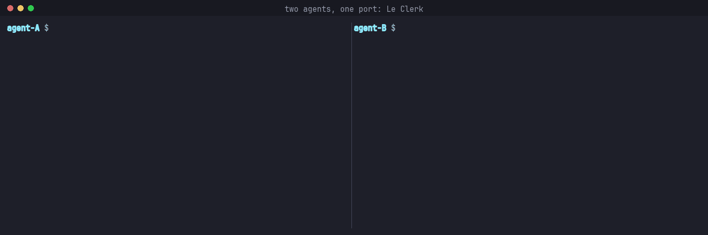

# Le Clerk

*"Un moment, s'il vous plaît… your esp32 is being prepared."*



Le Clerk (`clerk`) gives each of your coding agents its own turn with the
things they share: dev boards, serial ports, network ports, test services,
API tokens.

## The problem

Run a few Claude Code sessions on one machine and they start tripping over
each other. Two agents flash the same board at once. One agent asks another
"are you done with /dev/ttyACM0?" and waits for an answer that never comes.
Three identical boards sit on the hub while every agent queues for the
first one it found. A session crashes and the board it held stays "taken"
in everyone's notes.

Le Clerk replaces the chat with a lease. An agent asks for "a C6 board for
20 minutes", gets a specific free one with instructions on how to use it,
or a place in the queue, and is told when its turn comes. When it is done,
or dies, the board goes to whoever is next.

## What it feels like

You register your boards once (or ask an agent to: "register the boards on
my hub"). After that, an agent that needs one just leases it:

```text
$ clerk acquire c6-boards --for 20m --purpose "flash and test the OTA path"
(what the agent reads, abridged)

## Granted: c6-boards/c6-b
- ends_at: 2026-11-10 14:52 (in 20m)
- lease_id: lse_01M72…
- settings:
  - path: /dev/serial/by-id/usb-Espressif_…_CC-if00

### usage
Flash with `idf.py -p /dev/serial/by-id/…_CC-if00 flash`.
Hold BOOT while plugging in if the port does not appear.
Clean = erase flash and close the monitor.

Next: Use the unit, then `clerk release lse_01M72…` when you are done.
```

The demo at the top is the same idea with a network port: two Claude Code
agents both want to start the API dev server on 127.0.0.1:18080. The first
leases the port; the second is told who holds it and why, queues, and arms
a wait. When the first releases it, the clerk hands the port to the second,
which starts its server. No "address already in use", no guessing.

If every board is busy, it gets its place in the queue instead and arms a
wait. When the board comes back, the clerk wakes the idle session, hands it
the board, and the agent carries on. No polling, no messages between agents.

## Highlights

- **One command to a working unit.** Interchangeable units are pooled, so
  every free board is used before anyone queues. The grant carries the
  unit's path or address, its description, and your own usage notes, with
  `{unit.path}`-style placeholders filled in.
- **Agents are woken, not polled.** Notices (your turn, expiry soon, please
  yield, your board is back) reach an idle Claude Code session through a
  background `clerk wait`, which costs nothing until something happens.
- **Crashes don't leak boards.** A lease lives as long as the Claude Code
  process holding it. Kill the session and the board is free a minute
  later; `claude --continue` within that minute keeps it; `/clear` releases
  it at once.
- **The same thing is never leased twice.** Duplicate registrations of one
  physical board (by canonical path, device number and USB identity, even
  across projects) are detected and linked, so a lease on either blocks the other.
- **Fair, polite sharing.** Honest durations, warnings before expiry,
  extension, a cleanup step on every hand-back, and a "dirty" flag passed to
  the next holder when cleanup wasn't confirmed. An agent running past its
  end keeps the board until someone else wants it. Long, pausable work can be
  marked interruptible so an urgent short job can borrow the board and give
  it back. And when you say so, an agent can take a board anyway, with the
  reason in the audit log.
- **Health checks before every grant.** "The device exists and nobody has
  the port open", "something listens on this port", or your own script. A
  board stuck in a bootloader is skipped, not handed out.
- **Works for people and scripts too.** `clerk run c6-boards --for 15m --
  ./flash.sh` holds a board exactly as long as the command runs; `clerk
  acquire` on a terminal shows a live view; `clerk status` shows who holds
  what and who waits.

## How it fits together

One `clerk` binary is everything: it starts a small local daemon on first
use (a Unix socket in your runtime directory, SQLite for state), and talks
to it from the CLI. The Claude Code plugin adds one skill that teaches
agents the lease loop and four hooks that keep them informed. There is no
server to run and no account: no cloud service and no remote clients, only
a Unix socket in your runtime directory. (Some health checks, `tcp-connect`
and `http`, open connections to the unit they probe.)

## Install

Linux only; it needs Rust 1.91 or later to build.

```sh
cargo build --release
install -m 755 target/release/clerk ~/.local/bin/clerk

claude plugin marketplace add t3hk0d3/le-clerk
claude plugin install leclerk@leclerk --scope user
```

Then restart Claude Code. Agents need Claude Code 2.1.214 or later.

**Upgrading:** build and install the new `clerk`, run `clerk daemon restart`
(leases and queues survive), update the plugin with `claude plugin marketplace
update leclerk` and `claude plugin update leclerk@leclerk`, and restart Claude
Code.

## Good to know

- **Limits.** Ids match `^[a-z0-9][a-z0-9._-]{0,62}$`; a resource has at most
  16 tags of 1 to 32 characters; usage text is at most 4096 bytes; leases last
  at most 30 days. ([Concepts](docs/concepts.md#limits))
- **Priority.** `--priority low|normal|high` orders the queue, and lets a
  more urgent request ask an interruptible holder to pause.
  ([Concepts](docs/concepts.md#priority))
- **Configuration.** `config.toml` holds timings and retention (90 days for
  leases and the audit log). It is read when the daemon starts, so run
  `clerk daemon restart` after editing it; unknown keys are refused.
  `cleanup_extension` is the extra time `clerk extend <lease> --cleanup` adds
  to a cleanup window, once. ([CLI reference](docs/cli.md#files-and-configuration))
- **Trust.** Anything running as your user can talk to the daemon. `--override`
  for agents guards against mistakes, not against a hostile process.
  ([Trust model](docs/claude-code.md#trust-model))

## Documentation

- [Concepts](docs/concepts.md): resources and units, scopes, the lease
  lifecycle, priority, health checks, duplicates, notices, limits.
- [CLI reference](docs/cli.md): every command, output formats, exit codes,
  the daemon, files and configuration.
- [Claude Code](docs/claude-code.md): installing the plugin, what the hooks
  do, how sessions map to leases, the trust model.
- [Output format](docs/cli-output.md): what people and agents see.
- [Troubleshooting](docs/troubleshooting.md): the daemon log, error codes and
  exit codes, common failures.

For contributors: [STYLEGUIDE.md](STYLEGUIDE.md), [Testing](docs/testing.md)
(the automated suite and the manual Claude Code checklist) and
[the demo's README](scripts/demo/README.md).

## Status

Early, and local by design: one machine, one OS user. Linux only: liveness
tracking and the default device check read `/proc`. Used daily on a bench of
ESP32 boards, but expect rough edges.

## Development

```sh
cargo test
cargo clippy --all-targets -- -D warnings
cargo fmt --check
```

Conventions are in [STYLEGUIDE.md](STYLEGUIDE.md); the manual checklist is in
[docs/testing.md](docs/testing.md). Set `CLERK_HOME` to a scratch directory
to keep experiments away from your real state.

## License

Copyright (C) 2026 Igor Yamolov. Licensed under
[AGPL-3.0-only](LICENSE).
